# Bomber Quest #

***
## Table of Contents
1. [About the Project](#about-the-project)
2. [Features](#features)
3. [Getting Started and Installation](#getting-started-and-installation)
4. [Usage](#usage)
5. [Game Mechanics](#game-mechanics)
6. [Code Structure](#code-structure)
7. [Screenshots](#screenshots)
8. [Roadmap](#roadmap)
9. [Acknowledgments](#acknowledgments)
10. [Troubleshooting](#troubleshooting)

***
## About the Project
Bomber Quest is a 2D top-down strategy game where the player navigates through a maze, 
strategically places bombs, and defeats enemies. The goal is to destroy walls, 
eliminate all enemies, and escape through a hidden exit.

### Core Concepts:
- **Character Navigation**: The player moves through the maze, which consists of indestructible 
and destructible walls, to find paths to the exit.
- **Bombing Strategy**: Bombs can be dropped to destroy destructible walls and defeat enemies. 
Bomb placement requires careful planning to open up new pathways and avoid being caught in explosions.
- **Power-Ups**: Power-ups are hidden beneath destructible walls, enhancing the player’s bombing capabilities
such as blast radius, bomb count, speed, or shield.
- **Countdown Timer**: A timer adds urgency, challenging the player to complete objectives within a limited time.

`This project is created as part of a university assignment based on a given problem statement.`

***
## Features
- **Grid-Based Gameplay**: Navigate through tiles, place bombs, and destroy obstacles.
- **Dynamic HUD**: Displays real-time stats such as blast radius, remaining bombs, enemies, and game time.
- **Interactive Screens**: Includes Main Menu, Pause Menu, Victory, and Game-Over screens.
- **Custom Maps**: Load and play custom maps using a file chooser.
- **Sound Effects**: Immersive audio for explosions, power-ups, and game state transitions.
- **Seamless Screen Transitions**: Smooth navigation between gameplay and menu screens.
- **Power-Ups**: Enhance gameplay by increasing bomb capabilities or providing temporary shields.
- **Countdown Timer**: Adds urgency to gameplay by limiting the time available to complete levels

***
## Getting Started and Installation
To begin using Bomber Quest, follow these steps:

1. Clone the repository:
   ```bash
   https://ge62nib@artemis.tum.de/git/ITP2425ITP2425PROJECTWORK/itp2425itp2425projectwork-berivanyatkiseverogludila.git
   ```
2. Import the project into your preferred Java IDE (e.g., IntelliJ IDEA or Eclipse). Please follow the steps in this GIF.

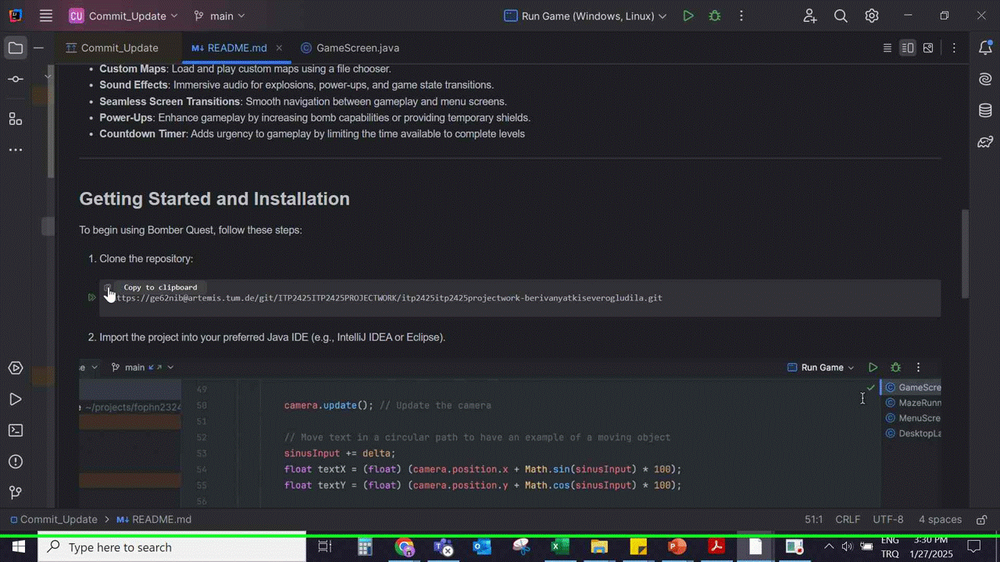
3. Ensure all provided libGDX dependencies are correctly configured.
4. Run the `BomberQuestGame` main class to start the game. You will need to edit the module which is used to run the program.
Please follow the steps in this GIF:
   
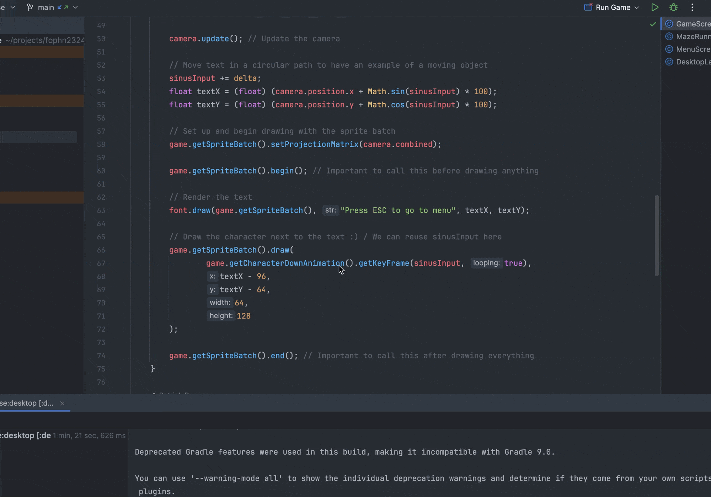

- **Please do not forget to choose the compatible system.**

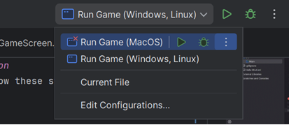

No additional software beyond the provided course template is required.

***
## Usage
- **Start the Game**: Run the game to enter the Main Menu. If you encounter any issues please review the [Troubleshooting](#troubleshooting) section.
 
  

 
- **Load the Map**: Click on the `Load Map` button to select a `Map`.
  
  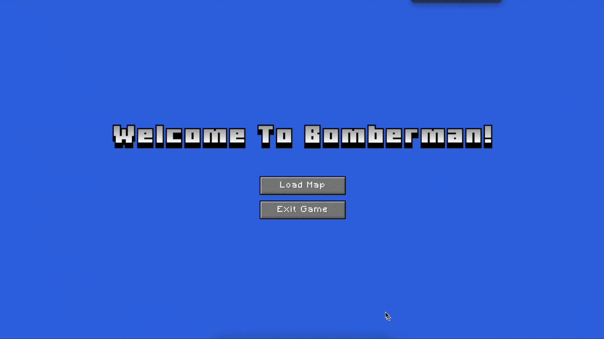


- **Controls**:
    - 1)`Arrow Keys` or `WASD`: Move the player.  
    - 2)`Spacebar`: Place bombs.
    - 3)`ESC`: Pause the game.
    - 4)`M`: Mute the game.

      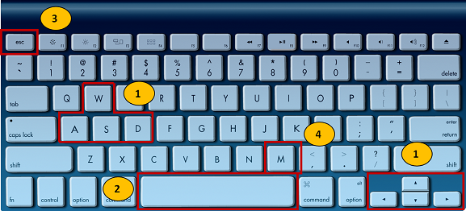


- **Objective**: Destroy walls, defeat enemies, and reach the exit before time runs out.

***
## Game Mechanics
- **Walls**: Indestructible walls block paths, while destructible walls can be destroyed by bombs to reveal power-ups.
- **Bombs**: Place bombs to create explosions that destroy walls and enemies.
- **Enemies**: Move randomly and can kill the player on contact. They are vulnerable to explosions.
- **Power-Ups**:
    - `Blast Radius`: Increases the range of bomb explosions.
    - `Concurrent Bombs`: Allows the player to place multiple bombs simultaneously.
    - `Speed`: Enhances player movement speed.
    - `Shield`: Temporarily protects the player from damage.
- **Exit**: Hidden beneath a destructible wall and unlocked after all enemies are defeated. The player must find and reach the exit to win.
- **Timer**: Adds urgency by limiting the time to complete levels. Killing an enemy adds 15 seconds to the game timer.

***
## Code Structure
The project follows an object-oriented approach with a clear class hierarchy:
- **Core Classes**:
    - `BomberQuestGame`: Manages game state and screen transitions.
    - `GameMap`: Handles game objects and interactions within the map.
- **Game Entities**:
    - `GameObject`: Base class for all game objects.
    - `Player`: Represents the player, with movement and interaction logic.
    - `Enemy`: Represents enemies with random movement and interaction logic.
    - `Bomb`, `Explosion`: Manage bomb mechanics and explosions.
    - `PowerUp`: Enhances player abilities (e.g., BlastRadius, ConcurrentBomb, Shield, Speed).
    - `Wall`: Includes IndestructibleWall and DestructibleWall.
- **Screens**:
    - `MenuScreen`, `GameScreen`, `PauseScreen`, `GameOverScreen`, `VictoryScreen`, `OutOfTimeScreen`.
- **Utilities**:
    - `Animations`, `Textures`: Manage graphics and animations.
    - `SoundEffect`, `MusicTrack`: Handle audio.
    - `CollisionCategories`, `GameMapContactListener`: Manage collisions and interactions.

### UML Diagram

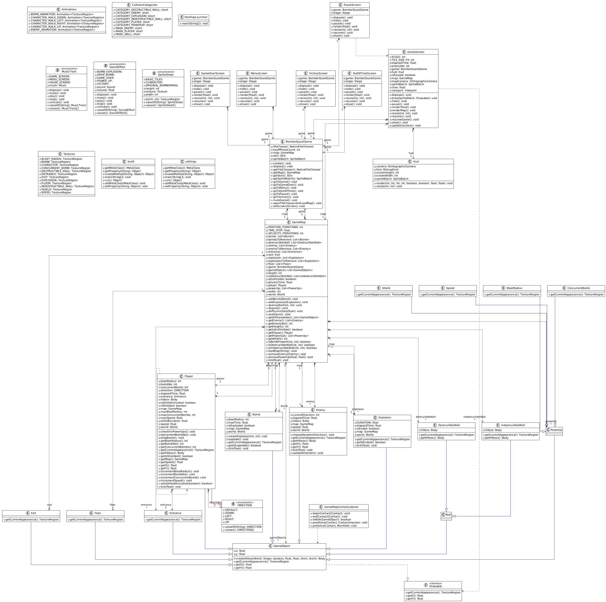

***
## Screenshots
- ### `Menu Screen`
  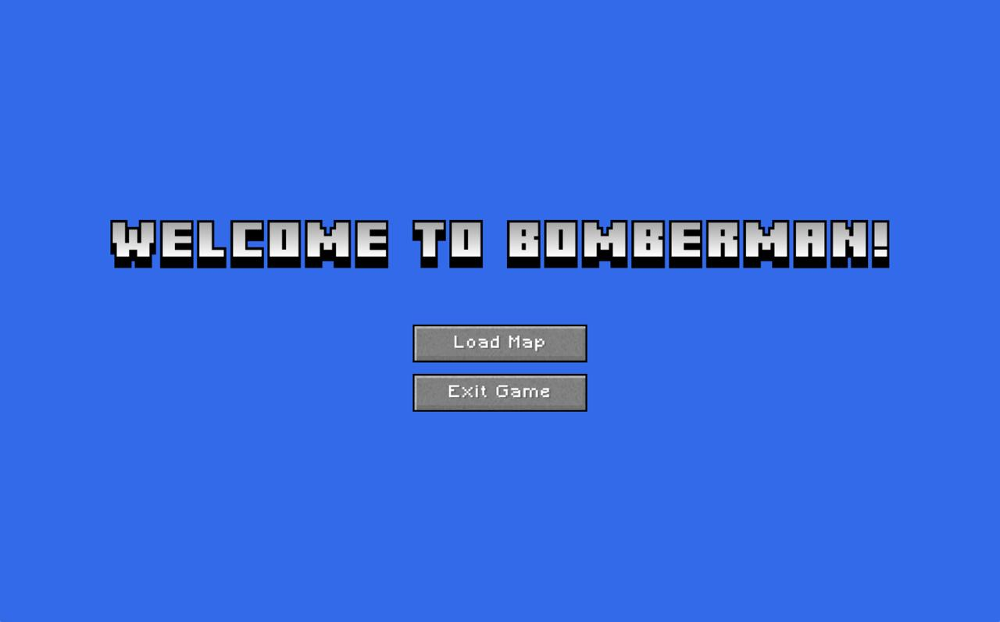

- ### `Game Screen`
  - Player movement, placing bombs, triggering explosions, collecting power-ups, and defeating enemies.
   
  

- ### `Pause Screen`
  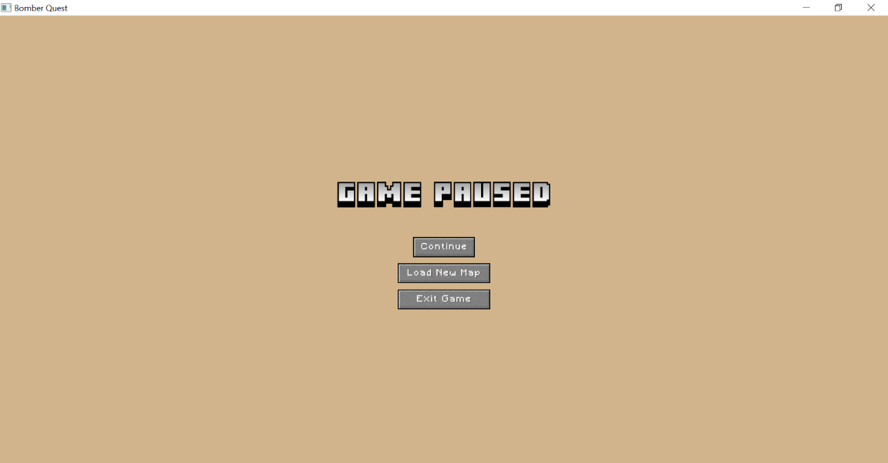

- ### `Game Over Screen`
  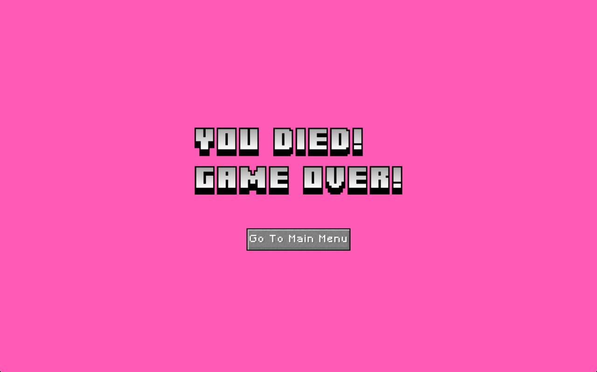

- ### `OutofTime Screen`
  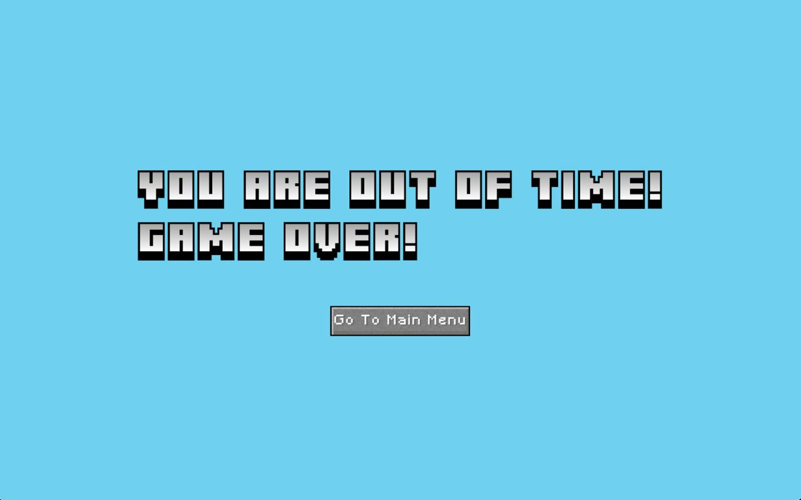

***
## Roadmap
- Smarter enemy movement
- Enemies placing bombs
- Multiplayer support
- Scoring system
- Multi-level maps

***
## Acknowledgments
- This project was developed collaboratively by Bug Busters 
(Berivan Yatki and Dila Severoglu) 
for the "Introduction to Programming" course.
- Developed using LibGDX.
- Inspired by classic Bomberman games.

***
## Troubleshooting
### Run Configurations
The way that libGDX must be executed differs based on what operating system you are using.

- On macOS, the VM option `-XstartOnFirstThread` needs to be present for libGDX to start.
- On Windows and Linux, this VM option will prevent libGDX from running.

Two different run configurations are included in the template: one with this VM option and one without. 
You should see them in the run configuration drop-down next to the green run arrow in IntelliJ. 
Please select the one that works for your machine.


### Fix Gradle JVM
If you encounter Gradle-related issues, click **Open Gradle Settings** and select the Project SDK as your Gradle JVM. 
You might need to re-run Gradle afterward. 
Open the Gradle Tool Window in **View > Tool Windows > Gradle** and hit the sync button (two arrows forming a circle).

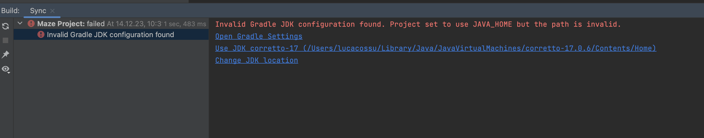

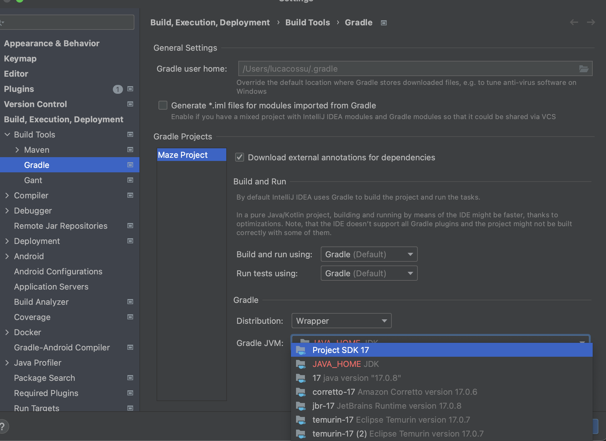


